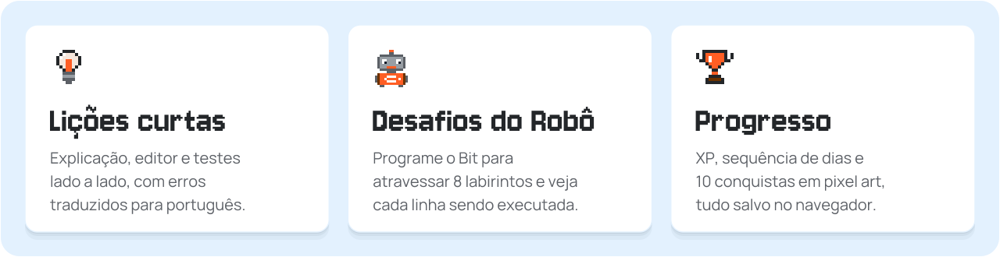
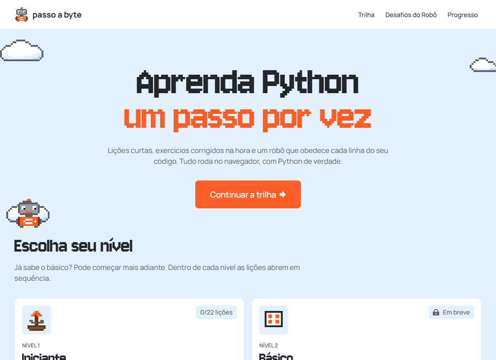
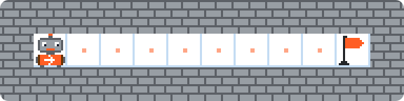
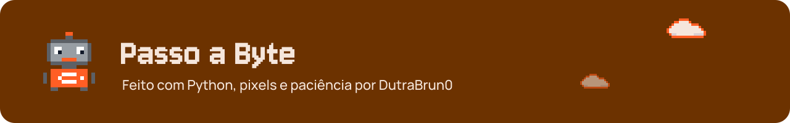

# Sobre o projeto

O **Passo a Byte** é uma plataforma para aprender programação do zero, sem nenhuma barreira no caminho:
**não precisa instalar nada, não precisa criar conta e não existe servidor**. Você abre o site, lê uma explicação
curta, escreve o código e recebe a correção na hora.

O Python do site não é uma imitação: é o **CPython 3.14 compilado para WebAssembly** (Pyodide), rodando num
Web Worker. As mensagens de erro e o comportamento são exatamente os do Python que a pessoa vai instalar depois.
A diferença é que aqui os erros chegam **traduzidos e explicados em português**, com a linha marcada no editor.

<p align="center">
  
</p>

<p align="center">
  
</p>

##  Funcionalidades

<table>
<tr>
<td width="50%" valign="top">

** Trilha de lições**
- Níveis → módulos → lições curtas, liberadas em sequência
- Explicação de um lado, editor **CodeMirror 6** e testes do outro
- Execução com <kbd>Ctrl</kbd> + <kbd>Enter</kbd>
- Cada teste mostra "esperado" × "seu código produziu"
- `input()` simulado: o teste "digita" pelo usuário

</td>
<td width="50%" valign="top">

** Ajuda na medida certa**
- Dicas reveladas uma de cada vez
- Solução comentada liberada depois de 3 tentativas
- Ver a solução antes de acertar vale metade do XP
- Erros traduzidos com título, explicação e linha marcada
- Rascunho do código salvo automaticamente

</td>
</tr>
<tr>
<td width="50%" valign="top">

** Progresso**
- XP por lição e sequência de dias estudando
- 10 conquistas em pixel art
- Tudo salvo no navegador (`localStorage`)
- Backup em JSON: exportar e importar

</td>
<td width="50%" valign="top">

** Experiência**
- Tela de carregamento em pixel art com o download real
- Responsivo para desktop e tablet
- Navegação por teclado e foco visível
- `prefers-reduced-motion` e regiões `aria-live`

</td>
</tr>
</table>

##  Desafios do Robô

<p align="center">
  
</p>

Você programa o **Bit** com funções como `andar()` para atravessar labirintos. O código roda e depois é
reproduzido passo a passo, com a linha atual destacada no editor. Tem **Executar, Pausar, Passo a passo,
Reiniciar** e controle de velocidade. As fases mais difíceis têm **limite de linhas**, então não dá para
repetir comando: é preciso usar laços.

| Fase | Nome | Fase | Nome |
|:----:|------|:----:|------|
| `01` | Primeiros passos | `05` | A chave |
| `02` | A primeira curva | `06` | Espiral |
| `03` | A escada | `07` | Chaves espalhadas |
| `04` | Corredor sem fim | `08` | O labirinto *(regra da mão direita)* |

##  Conteúdo

| Nível | Módulos | Status |
|-------|---------|:------:|
| **1 · Iniciante** | Mostrando coisas na tela · Variáveis · Tipos de dados · Operadores · Conversando com o usuário · Tomando decisões |  |
| **2 · Básico** | Laços `for` · Laços `while` · Listas · Strings · Funções |  |
| **3 · Intermediário** | Dicionários · Tuplas e conjuntos · Funções · Erros · Compreensões · Biblioteca padrão |  |
| **4 · Avançado** | Classes · Herança · Decoradores e geradores · Recursão · Algoritmos · Testes |  |
| ** Robô** | 8 fases |  |

> [!NOTE]
> Os níveis 2 a 4 já aparecem na trilha com seus módulos. Falta escrever as lições, o que é feito só com
> arquivos Markdown, sem mexer em código.

##  Tecnologias

| Área | Ferramentas |
|------|-------------|
| Interface | React 19 · React Router 7 · Tailwind CSS 4 |
| Editor | CodeMirror 6 |
| Execução de Python | Pyodide (CPython 3.14 em WebAssembly) · Web Worker |
| Estado | Zustand · regras de progresso em funções puras |
| Conteúdo | Markdown + YAML, convertidos para JSON no build por um plugin do Vite |
| Testes | Vitest (com o Pyodide real em Node) · Playwright |
| Qualidade e deploy | ESLint · GitHub Actions · Vercel |

<a id="como-rodar"></a>

##  Como rodar

> [!TIP]
> Requisito: **Node.js 20** ou mais recente.

```bash
git clone https://github.com/DutraBrun0/passo-a-byte.git
cd passo-a-byte
npm install
npm run dev          # http://localhost:5173
```

| Comando | O que faz |
|---------|-----------|
| `npm run dev` | servidor de desenvolvimento (copia o Pyodide para `public/pyodide/` antes) |
| `npm test` | testes unitários e de conteúdo com Vitest |
| `npm run test:e2e` | testes no navegador com Playwright (rode `npx playwright install chromium` uma vez) |
| `npm run lint` | ESLint |
| `npm run build` | build de produção em `dist/` |
| `npm run check` | lint + testes + build, o mesmo que a CI roda |
| `npm run demo:gif` | grava o `docs/demo.gif` com o Playwright |

##  Como funciona por dentro

### Arquitetura

O projeto separa o que é **genérico** (trilha, progresso, robô, páginas) do que é **específico de uma linguagem**.
O núcleo não sabe nada de Python: ele conversa com um *adaptador de linguagem* que segue um contrato
([`contrato.js`](src/nucleo/linguagens/contrato.js)). Adicionar JavaScript ou SQL no futuro significa escrever um
novo adaptador, sem tocar nas páginas.

```text
src/
├── nucleo/          ← independente de linguagem
│   ├── linguagens/  contrato do adaptador + registro
│   ├── execucao/    supervisor do Worker (fila, timeout, recriação)
│   ├── conteudo/    monta o curso a partir de content/
│   ├── progresso/   regras de XP, sequência e conquistas
│   └── robo/        simulador do labirinto (JS puro) e reprodutor
├── linguagens/
│   └── python/      adaptador, Worker, executor.py, tradução de erros
├── design-system/   tokens, componentes e sprites em pixel art
├── editor/          CodeMirror, tema e Markdown
└── paginas/         início, trilha, lição, robô e progresso
```

###  Execução segura do código do aluno

| | Camada | Como funciona |
|:-:|--------|---------------|
| 1 | **Web Worker** | o código nunca roda na thread principal, então a página não trava |
| 2 | **Limite de passos e tempo** | `sys.settrace` conta só as linhas do aluno |
| 3 | **Cão de guarda** | se o Worker não responder em 10 s, ele é encerrado e recriado |
| 4 | **Sem rede** | `fetch`, `XMLHttpRequest`, `WebSocket` e afins são desativados depois da carga |
| 5 | **Ambiente restrito** | imports só de uma lista da biblioteca padrão; `open`, `eval`, `exec` e `compile` removidos |

### Como o robô é animado

```text
Thread principal                       Web Worker
────────────────                       ──────────
robo.executar(codigo, fase) ─────────▶ roda o programa inteiro de uma vez
                                       cada andar() vira um passo do trace
◀───────────────────────────────────── trace = [{ acao, linha, estado }, ...]
reprodutor percorre o trace
canvas desenha trace[i].estado
editor destaca trace[i].linha
```

Cada passo carrega o estado completo do robô, então pausar, avançar um passo ou reiniciar são só mudanças de índice.

<details>
<summary><b>Por que Pyodide e não Skulpt?</b></summary>
<br>

| | Pyodide ✅ | Skulpt |
|---|---|---|
| O que é | CPython compilado para WebAssembly | reimplementação de Python em JavaScript |
| Download | ~12 MB na primeira visita, depois cache | ~1 MB |
| Fidelidade | Python 3.14 real, mesmas mensagens de erro | subconjunto, com diferenças de comportamento |
| `sys.settrace` | sim (limite de passos e linha do robô) | não |

Para quem está aprendendo, a fidelidade pesa mais do que o tamanho. O download foi compensado com carregamento sob
demanda, barra de progresso, cache permanente (service worker) e execução em Worker.

</details>

<a id="como-adicionar-uma-licao"></a>

##  Como adicionar uma lição

A estrutura de pastas em `content/` **é o índice do curso**: o prefixo numérico define a ordem e o resto do nome vira
o id que aparece na URL.

```text
content/python/
├── 1-iniciante/
│   ├── nivel.json              ← título, descrição e ícone do nível
│   └── 01-print/
│       ├── modulo.json         ← título e descrição do módulo
│       └── 01-ola-mundo.md     ← uma lição
└── robo/
    └── 01-primeiros-passos.md  ← uma fase do robô
```

Cada lição é um `.md` com o exercício num cabeçalho YAML:

````markdown
---
titulo: Divisão inteira e resto
xp: 15
exercicio:
  enunciado: |
    Com `minutos = 125`, mostre `2 horas e 5 minutos`.
  codigo_inicial: |
    minutos = 125
  testes:
    - tipo: saida
      nome: Mostra "2 horas e 5 minutos"
      esperado: 2 horas e 5 minutos
  dicas:
    - "Para descartar a parte decimal, use `//`."
  solucao: |
    minutos = 125
    print(minutos // 60, "horas e", minutos % 60, "minutos")
---
Texto da lição em Markdown, com exemplos.
````

| Tipo de teste | O que verifica |
|---------------|----------------|
| `saida` | o que o programa imprimiu |
| `variavel` | o valor ou o tipo de uma variável |
| `funcao` | o retorno de uma função do aluno |
| `python` | um `assert` livre |
| `estrutura` | o código sem executar: construções exigidas ou proibidas |

> [!IMPORTANT]
> O `npm test` valida **toda lição automaticamente**: a solução de referência precisa passar em todos os testes e o
> código inicial precisa falhar, para evitar exercício trivial por engano.

##  Testes e CI

- **Vitest:** executor Python no Pyodide real, tradução de erros, supervisor do Worker, simulador do robô,
  progresso e conquistas, montagem do conteúdo, sprites e todas as lições e fases.
- **Playwright:** Pyodide no Chromium, loop infinito e recuperação do Worker, lição completa, trilha e bloqueios,
  exportar e importar progresso, robô com passo a passo.
- **GitHub Actions** ([`ci.yml`](.github/workflows/ci.yml)): lint, testes e build a cada push e pull request,
  seguidos dos testes no navegador.

##  Design

<p>


</p>

- **Tipografia:** Jersey 10 nos títulos grandes, Manrope no resto.
- **Uma só cor de destaque:** o laranja, com um único botão laranja preenchido por tela.
- **Pixel art de verdade:** sprites definidos como grades de caracteres ligadas aos tokens de cor, desenhados em
  canvas com `image-rendering: pixelated`. Um teste garante que todo sprite usa só cores da paleta.

As imagens deste README (banner, botões, cards e ícones) foram geradas a partir dos mesmos sprites do site.

##  Próximos passos

- [ ] Escrever as lições dos níveis Básico, Intermediário e Avançado
- [ ] Editor de fases do robô com compartilhamento por link
- [ ] Novas linguagens (JavaScript, SQL, C, Java) usando o contrato de adaptador
- [ ] Interrupção imediata do código com `SharedArrayBuffer`
- [ ] Efeitos sonoros e busca nas lições
- [ ] Cabeçalhos de segurança (CSP) na Vercel

<br>

<a href="https://github.com/DutraBrun0">
  
</a>
